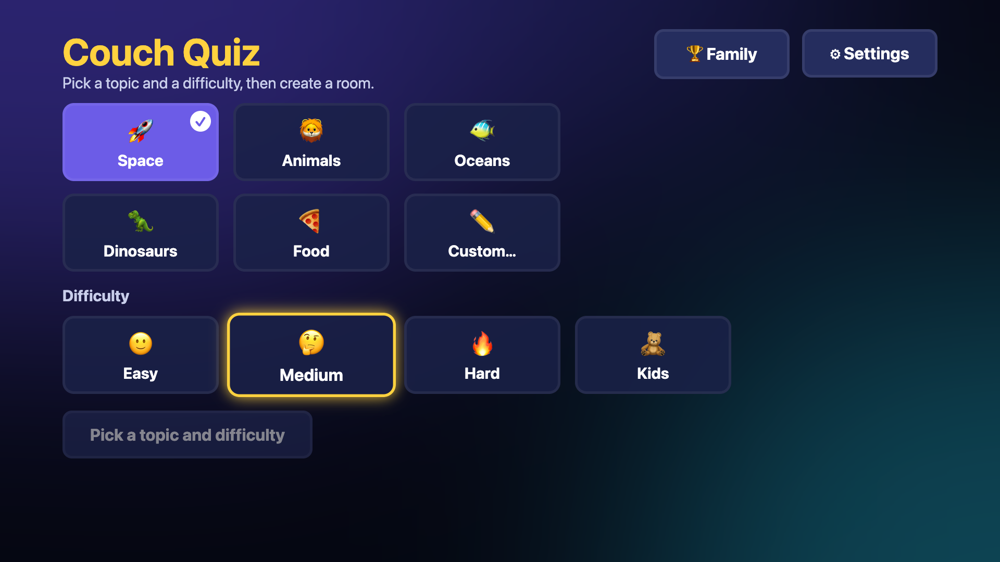
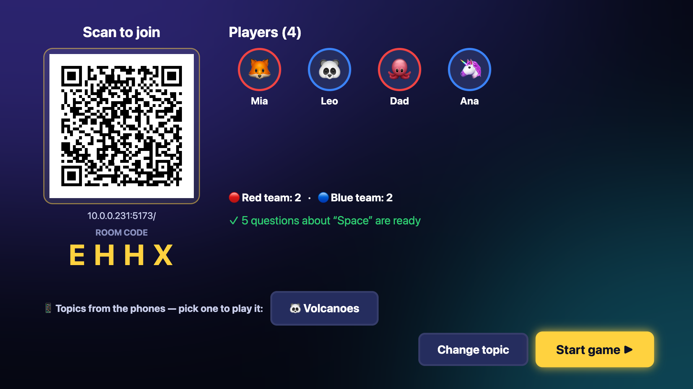
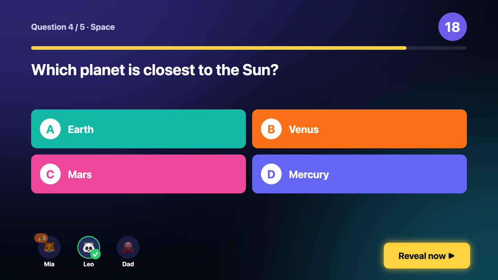
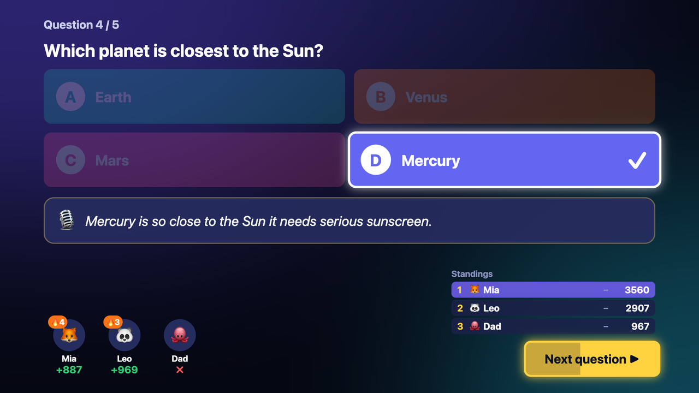
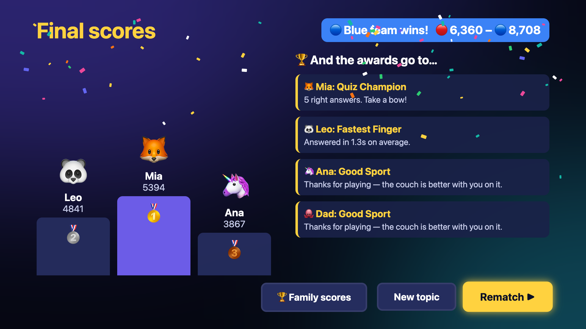
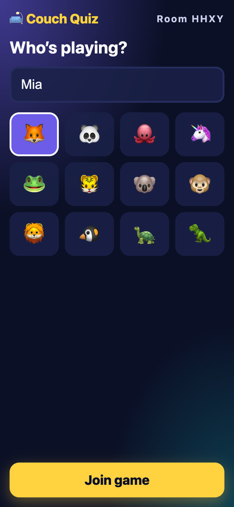
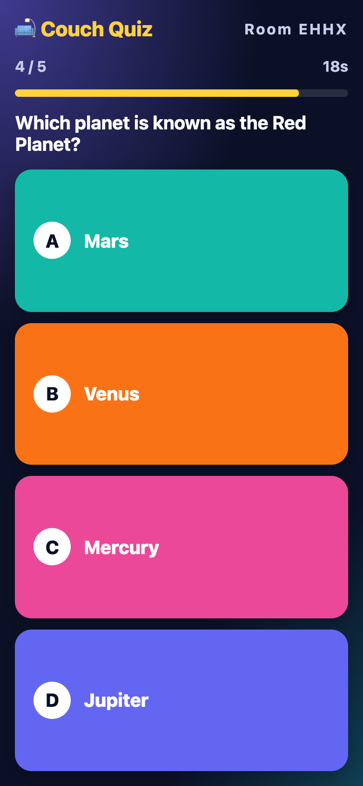
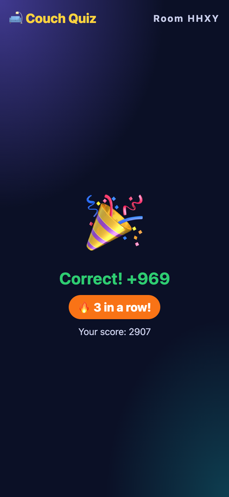
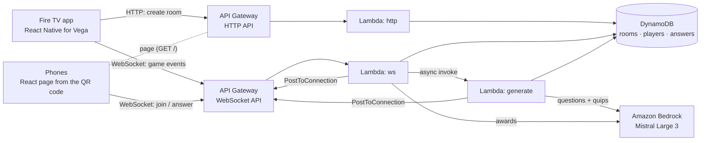

# Couch Quiz

An AI-hosted family trivia game for Fire TV (Vega OS). The TV is the game board, driven with the remote's D-pad. Players join by scanning a QR code and use their phones as answer pads — no app install for players. An AI host on Amazon Bedrock writes the questions for any topic ("space for kids", "our family trip to the beach", "90s cartoons"), cracks a joke after every answer, and hands out awards at the end.

> Built for the Build, Ship, Shape: Amazon Developer Hackathon (Fire TV track).

| Setup (D-pad) | Lobby (QR join) | Question |
|---|---|---|
|  |  |  |
| **Reveal** | **Podium** | **Phones** |
|  |  |    |

## How a game works

1. **Setup (TV):** pick a topic and a difficulty — Easy, Medium, Hard or Kids (simpler questions, no timer). For your own topic, type it with the TV keyboard or pick one of three **"Surprise me" ideas** from the AI host with the D-pad (no typing).
2. **Lobby (TV + phones):** the TV shows a QR code and a 4-letter room code. Each player scans it, types a name and picks an avatar; they appear on the TV live. Preset topics come from the built-in question bank instantly; for a custom topic the AI host writes the questions while players join, and a **second AI model fact-checks them** (flagged questions are swapped for spares). **Players can suggest a topic from their phones**; suggestions appear on the TV and the host plays one with a click.
3. **Questions:** a short "Question N" intro, then the TV shows the question and a countdown while phones show four big answer buttons. Faster correct answers score more (500–1000 points; a flat 1000 in Kids mode). The **final question is worth double points**. The question ends when everyone has answered or time runs out.
4. **Reveal:** the TV highlights the answer, shows the host's quip, everyone's points, 🔥 streak badges (3+ correct in a row) and an animated leaderboard where players slide to their new rank. The game moves on by itself after a few seconds (or right away with the remote).
5. **Podium:** final ranking with confetti, plus an award for every player ("Fastest Finger", "Comeback Kid"…) written by the AI host from real game stats (rule-based when the AI is unavailable). **Rematch** starts a new game on the same topic with the same players — nobody re-scans the QR code, and the AI host is told not to repeat the previous questions. **New topic** goes back to Setup, players still in the room.

Phones that lose the connection rejoin automatically with their name and score.

**Teams.** In Settings, "2 teams" splits the players into a 🔴 red and a 🔵 blue team, balanced as they join (team-colored rings in the lobby, a badge on each phone). The reveal shows both team totals next to the leaderboard, and the podium announces the winning team.

**Family scores.** Every finished game adds to a family table kept per TV (wins, games, points and best game per person, matched by name), stored in DynamoDB under a random family id the TV creates on first run. Open it from Setup (🏆 Family) or the podium.

**Question bank.** [`question-bank.json`](packages/protocol/src/question-bank.json) holds 150 questions (5 topics × easy/medium/hard × 10, each with a host quip; Kids mode uses the easy ones), and [`question-bank.es.json`](packages/protocol/src/question-bank.es.json) 150 more in Spanish. Questions of a **completed** game (one that reached the podium) are not served again for that topic and level; an abandoned game can come back. When a topic is used up, the AI host writes a fresh game (or, without AI, a new cycle starts). To grow the bank, `yarn workspace @couch-quiz/backend expand-bank` writes new games with Bedrock (Mistral Large 3, told to avoid the questions already in the bank) and has a second model (Qwen3 235B) fact-check every question. Nothing is added directly: the candidates land in `bank-review/` with a `review.<lang>.md` that lists flagged questions first; after reviewing, `yarn workspace @couch-quiz/backend merge-bank --lang en` adds the ones that passed (and any flagged ones you marked `"approved": true`).

**Settings.** From the Setup screen (⚙): language (English or Spanish — applies to the TV, the phones, the question bank and the AI host), questions per game (5 or 10), teams (off or 2 teams), sound effects and music on/off. Settings are saved on the TV (AsyncStorage on Vega, localStorage on web).

**Sound.** The TV plays lobby music and effects (player joined, answer locked in, last-seconds ticks, time's up, reveal, podium fanfare). All sounds are original, synthesized by [`make-sounds.py`](backend/scripts/make-sounds.py), and streamed from the backend (`GET /sounds/{name}.m4a`). Phones stay silent so the room isn't a cacophony.

## Architecture



All game rules live in one transport-independent class, [`GameService`](backend/src/game/GameService.ts). The Lambda handlers and the local development server are thin adapters around it, so what you test locally is what runs in AWS. The TV is the source of truth for the game phase (start question, reveal, end game); the backend stores state, timestamps and scores answers, and fans events out to the TV and the phones.

## Built for Vega

- **10-foot UI on the D-pad:** every screen is navigable with up/down/left/right/select/back ([react-tv-space-navigation](https://github.com/bamlab/react-tv-space-navigation)). Focus is a yellow ring with glow and a springy scale; "selected" is a purple fill with a check, so the two are never confused. Selecting a topic moves focus to difficulty, then to "Create room".
- **Back** goes one step back on every screen, opens a "Quit this game?" dialog during a game, and exits the app from the first screen.
- **TV keyboard** for custom topics, with a hint for closing it (on Vega's keyboard Select types the highlighted key).
- **Animations** use the native driver (smooth countdown bar, focus springs, staggered answers, sliding leaderboard, confetti).
- **Sound** with the W3C media `AudioPlayer`; it only plays HTTPS sources and does not replay after `ended`, so every effect uses a fresh preloaded player ([`sounds.vega.ts`](packages/shared-ui/src/audio/sounds.vega.ts)).
- **Saved settings** with the Vega port of AsyncStorage.
- Everything we tripped over is in the [friction log](docs/friction-log.md).

## AWS integrations

Everything is defined with AWS CDK (TypeScript) in [`infra/lib/couch-quiz-stack.ts`](infra/lib/couch-quiz-stack.ts).

| Service | What it does in Couch Quiz | Code |
|---|---|---|
| **Amazon API Gateway — HTTP API** | `POST /rooms` creates a room (code, host token, join URL; the TV sends its family id); `GET /rooms/{code}` lets a phone check a code before joining; `GET /families/{id}` returns the family scores; `GET /topic-ideas` returns "Surprise me" topics; `GET /sounds/{file}` streams the TV's sound effects over HTTPS (Vega's media player requires HTTPS); `GET /`, `GET /assets/{file}` and `GET /config.json` serve the phone page the QR code opens (the built Vite app ships inside the function). CORS enabled for the phone page. | [`handlers.ts` → `http`](backend/src/aws/handlers.ts) |
| **Amazon API Gateway — WebSocket API** | Real-time channel for the TV and every phone. `$connect` authenticates (host token / room code), `$disconnect` marks players offline, `$default` carries all game messages. The backend pushes events with `PostToConnection`. | [`handlers.ts` → `ws`](backend/src/aws/handlers.ts) |
| **AWS Lambda** (Node.js 22, arm64) | Three functions bundled with esbuild from the same entry file: `http`, `ws` and `generate`. Question generation takes seconds, so `ws` invokes `generate` asynchronously (`InvocationType: Event`) and returns immediately; `generate` pushes the result to the TV when it is ready. | [`handlers.ts`](backend/src/aws/handlers.ts) |
| **Amazon DynamoDB** | One on-demand table (`pk`/`sk`) with TTL (24 h). Items: room `ROOM#ABCD/META`, players `ROOM#ABCD/PLAYER#id`, answers `ROOM#ABCD/ANSWER#03#playerId` (a conditional put guarantees one answer per player per question), connections `CONN#id/META`, bank questions from completed games `PLAYED/space#easy`, and family scores `FAMILY#id/META` (no TTL). Answers are keyed by game round (`ANSWER#2#03#playerId`), so a rematch in the same room starts clean. | [`dynamoStore.ts`](backend/src/aws/dynamoStore.ts) |
| **Amazon Bedrock** — Mistral Large 3 (`mistral.mistral-large-3-675b-instruct`) writes, DeepSeek V3.1 (`deepseek.v3.1`) fact-checks, through the OpenAI-compatible `bedrock-mantle` endpoint | Chat Completions with `response_format: json_schema` (`submit_questions` / `submit_awards`), signed with SigV4 by the Lambda role — no API keys. The model is one CDK context value (`modelId` in [`cdk.json`](infra/cdk.json); we compared Gemma 3 27B, Qwen3 235B, DeepSeek V3.1 and Mistral Large 3 and kept Mistral for accuracy and speed, ~6 s for 10 questions); the Converse API (e.g. Amazon Nova, with forced tool use) is supported too (`aiApi: converse`). Live custom games are **fact-checked by a second model** (DeepSeek V3.1, `checkerModelId`): the writer produces 3 spare questions, the checker returns a verdict per question (matched by the echoed answer, not just the number), and the game keeps the first ones that passed. The same writer also suggests topic ideas. The output is validated with zod (10 questions, 4 unique short choices, one correct answer, length limits for TV readability) and retried up to 3 times with the validation errors as feedback. Choices are shuffled server-side so the right answer isn't always in the same slot. Awards are grounded in computed facts (rank, speed, streak, places climbed); if Bedrock fails, rule-based awards are used. Preset topics play from the built-in bank without Bedrock; custom topics need model access in the account. | [`mantleAi.ts`](backend/src/aws/mantleAi.ts), [`bedrockAi.ts`](backend/src/aws/bedrockAi.ts), [`ai.ts`](backend/src/game/ai.ts) |
| **Amazon S3 + Amazon CloudFront** (optional, `site: cloudfront`) | Alternative host for the phone page: private bucket (Origin Access Control) served over HTTPS by CloudFront, with a `config.json` written by CDK next to it. Not used by default because new AWS accounts must be verified by AWS Support before they can create CloudFront distributions. | [stack](infra/lib/couch-quiz-stack.ts) |
| **AWS IAM** | Least-privilege grants from CDK: table read/write, `execute-api:ManageConnections` on the WebSocket stage, `lambda:InvokeFunction` on `generate` only, and `bedrock-mantle:CreateInference` limited to the configured writer and checker models (`bedrock-mantle:Model` condition; `bedrock:InvokeModel` on the model's inference profile with the Converse API). | [stack](infra/lib/couch-quiz-stack.ts) |
| **Amazon CloudWatch Logs** | One log group per function, one-week retention; Bedrock latency and token usage are logged per call. | [stack](infra/lib/couch-quiz-stack.ts) |

## Repository layout

| Path | What it is |
|---|---|
| `apps/vega` | Fire TV app for Vega OS (React Native for Vega) |
| `apps/expo-multi-tv` | The same TV app for web and Android TV (used for fast UI iteration) |
| `apps/controller` | Phone page (Vite + React) |
| `packages/shared-ui` | TV screens, focus components and game clients shared by both TV apps |
| `packages/protocol` | Types, messages and game rules shared by TV, phones and backend |
| `backend` | `GameService` + adapters: Lambda handlers, DynamoDB store, Bedrock AI host, local server |
| `infra` | AWS CDK app |
| `docs/friction-log.md` | Issues found in the Vega SDK, docs and tooling while building this |
| `docs/demo-script.md` | Script for the 3-minute demo video |
| `docs/devpost.md` | Project description for the Devpost submission |
| `docs/images/` | Screenshots used in this README |

## Running it locally

Requires Node.js 22 LTS and Yarn 4 (`corepack enable`). No AWS account is needed for local play.

```sh
yarn install
yarn play             # all of the below in one terminal
```

Or one by one:

```sh
yarn dev:server       # game server on :8787 (in-memory, bundled questions)
yarn dev:controller   # phone page on :5173 (also on your Wi-Fi IP, which the QR code uses)

# TV in the browser, connected to the local server
# (arrow keys = D-pad, Enter = select, Esc = back)
EXPO_PUBLIC_HTTP_URL=http://localhost:8787 EXPO_PUBLIC_WS_URL=ws://localhost:8787 yarn dev:web
```

Open http://localhost:8082, create a room, and scan the QR code with phones on the same Wi-Fi. Without the two `EXPO_PUBLIC_*` variables the web TV plays against three built-in bots.

To use Amazon Bedrock from the local server with your AWS credentials: `AI=mantle yarn dev:server` (Mistral Large 3; `AI=bedrock` for the Converse API, optionally `MODEL_ID=...`). `yarn workspace @couch-quiz/backend try-ai "volcanoes" easy en 10` prints a generated game.

### Against the AWS backend

`yarn play:aws` starts the phone page and the web TV pointed at the deployed backend (no local game server). The join link in the QR code carries the backend's URLs (`?room=…&api=…&ws=…`), so phones always talk to the backend that created the room.

### On the Vega Virtual Device

`VEGA_SERVER` in [`packages/shared-ui/src/config.ts`](packages/shared-ui/src/config.ts) picks the backend for the Vega app: `AWS_SERVER` (default) or `LOCAL_SERVER` (`yarn dev:server`, reached through port forwarding on 8787).

```sh
vega virtual-device start
yarn build:vega:debug
yarn dev:vega                                   # Metro, keep running
vega device start-port-forwarding --device VirtualDevice -p 8081 --forward false   # Metro
vega device start-port-forwarding --device VirtualDevice -p 8787 --forward false   # game server
vega run-app apps/vega/build/aarch64-debug/vega_aarch64.vpkg com.romeodev.couchquiz.main -d VirtualDevice
```

Use the `x86_64` package on Intel Macs.

## Deploying to AWS

```sh
cd infra
npx cdk bootstrap        # once per account/region
yarn deploy              # builds the phone page, then cdk deploy
```

The stack prints `HttpApiUrl`, `WebSocketUrl` and `ControllerUrl`. Put the first two in `AWS_SERVER` in `config.ts` (and in the `play:aws` script for web), then rebuild the TV app. The Bedrock model and API are the `modelId` and `aiApi` context values in [`infra/cdk.json`](infra/cdk.json).

The phone page is served by the HTTP API itself, so `ControllerUrl` is the API's root URL and any phone can join from anywhere. The `site` context value in [`infra/cdk.json`](infra/cdk.json) chooses who serves it:

| `site` | Phone page served by |
|---|---|
| `lambda` (default) | The HTTP API + Lambda (`GET /`). Works on any account. |
| `cloudfront` | S3 + CloudFront. New AWS accounts must be verified by AWS Support first. |
| `local` | Your machine: `npx cdk deploy -c site=local -c controllerUrl=http://<your-LAN-IP>:5173/` with `yarn dev:controller` running. |

## Credits

Based on [AmazonAppDev/react-native-multi-tv-app-sample](https://github.com/AmazonAppDev/react-native-multi-tv-app-sample) (MIT-0). Focus and 10-foot UI patterns follow [AmazonAppDev/vega-tv-interfaces-sample](https://github.com/AmazonAppDev/vega-tv-interfaces-sample).

## License

[MIT](LICENSE)
